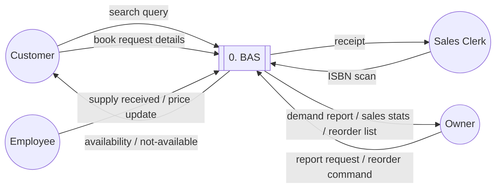
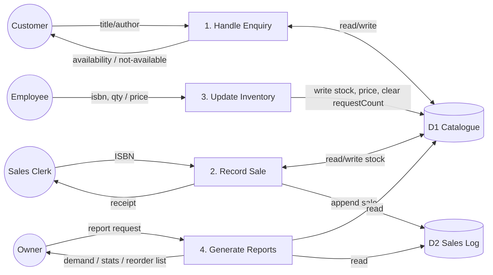
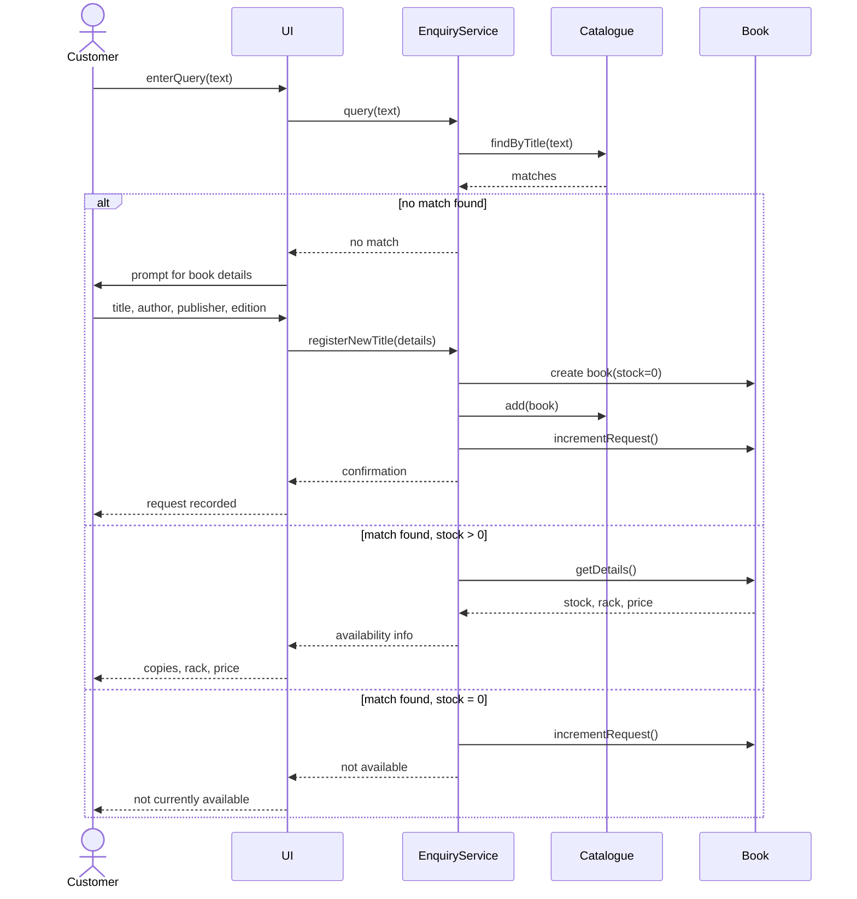
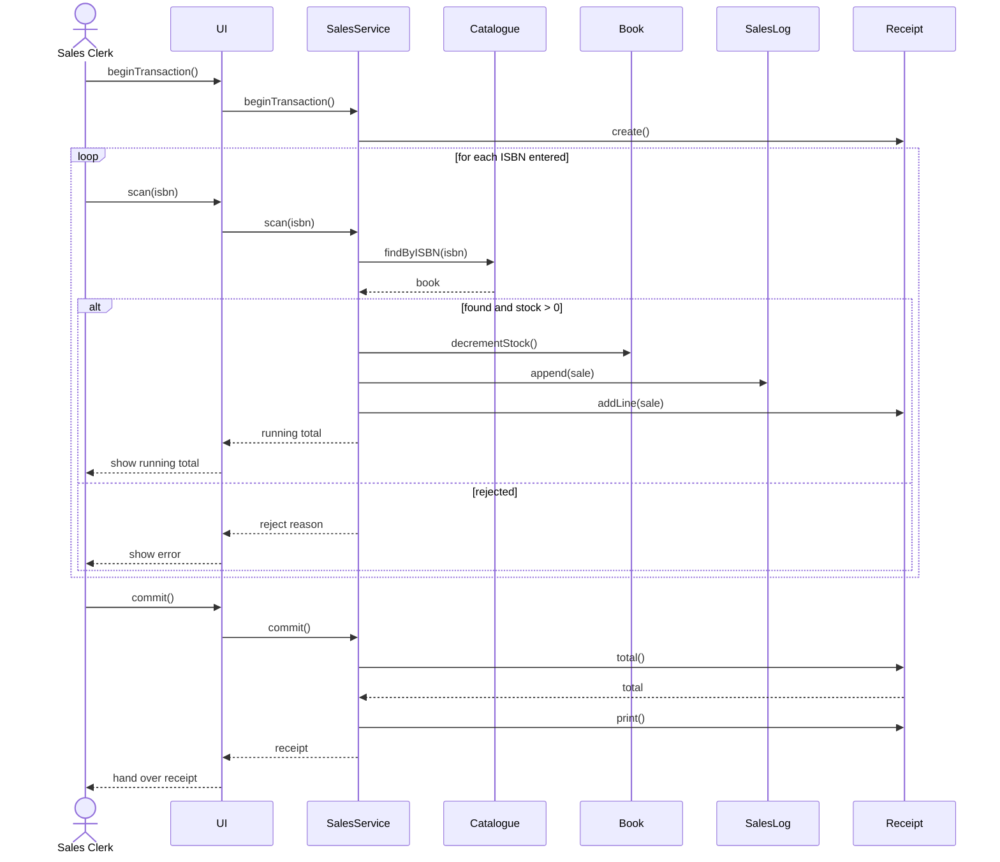
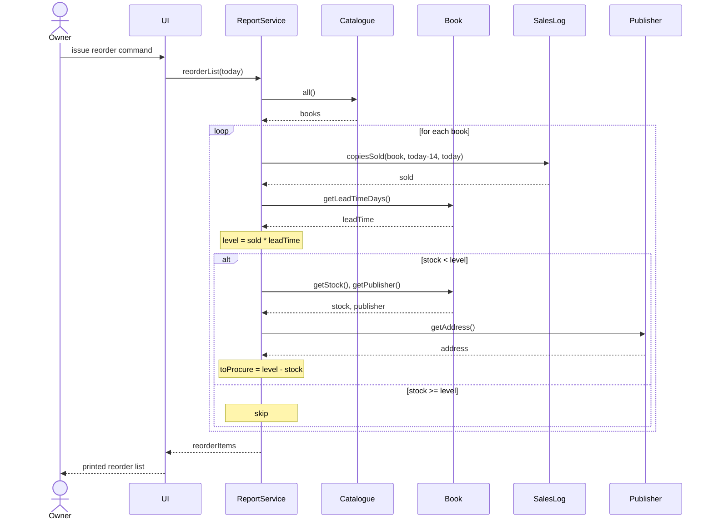
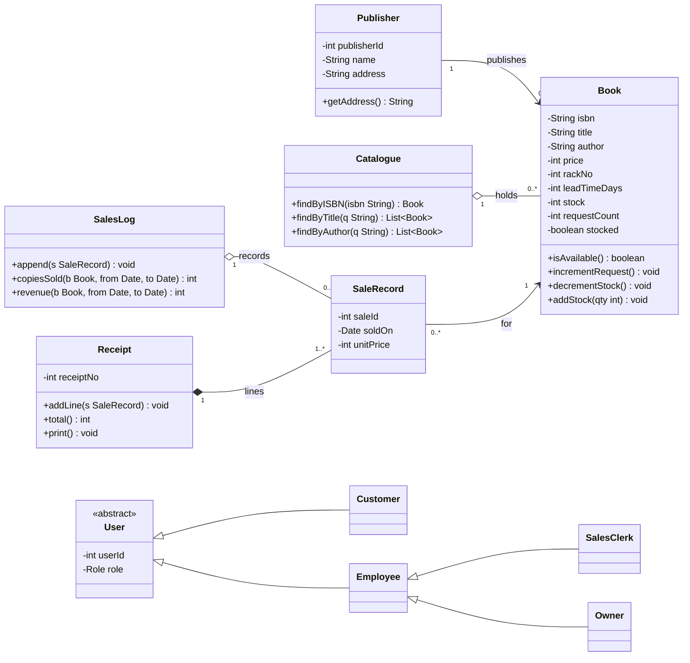
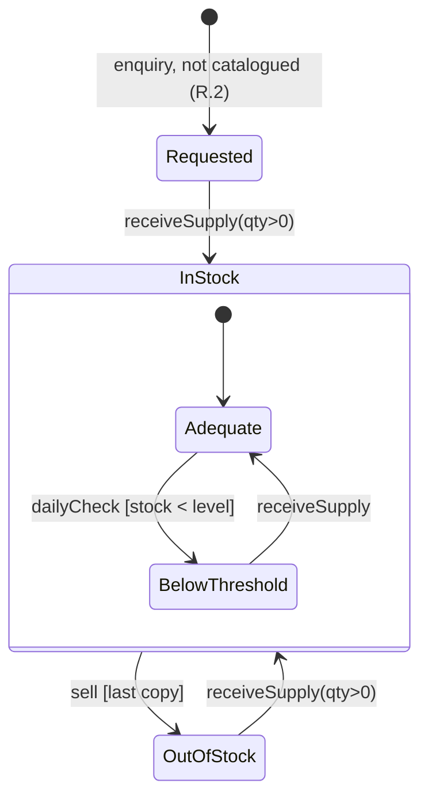
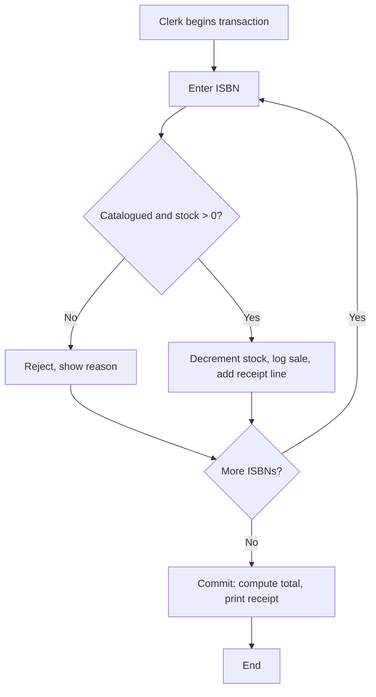

# Book-shop Automation Software (BAS)

Project spec for Claude Code. This file is `CLAUDE.md` at the repo root and loads automatically as context. Diagram source files referenced below live in `docs/diagrams/`; if they are not yet present, regenerate them from the Mermaid/PlantUML blocks in this document before building the corresponding UI so the two stay in sync.

## 1. What this is

A single-shop system covering four functions: customer availability enquiry, point-of-sale, inventory receiving, and owner reporting (demand, sales stats, daily reorder list). Nine numbered requirements (R.1-R.9) are referenced throughout this doc and should be traceable to code via comments (`// R.5` etc.) at the point each rule is enforced.

## 2. Tech stack

- **Backend**: Node.js, Express, TypeScript, PostgreSQL, Prisma ORM
- **Frontend**: React, TypeScript, Vite, TailwindCSS, React Router, TanStack Query
- **Auth**: JWT (staff only), bcrypt for password hashing
- **Testing**: Vitest (unit, both sides), Supertest (backend API), React Testing Library (components), Playwright (e2e/integration)
- **Tooling**: ESLint, Prettier, Docker Compose (local Postgres)

Money is stored as integer paise everywhere, never floats. ISBN is the DB primary key for `Book`.

## 3. Roles

| Role | Auth required | Can do |
|---|---|---|
| Customer | No | Search, register a procurement request |
| Sales Clerk | Yes | Record sales |
| Employee | Yes | Receive supply, update price/rack/lead time |
| Owner | Yes (inherits Employee) | All reports, reorder list |

## 4. Data flow diagrams

### Level 0 (context)



### Level 1



## 5. Use case summary

| Use case | Actor | Requirement |
|---|---|---|
| Enquire About Availability | Customer | R.1 |
| Register Procurement Request | Customer (extends enquiry, no match) | R.2 |
| Increment Request Count | Customer (extends enquiry, stock = 0) | R.3 |
| Maintain Book Price | Employee | R.4 |
| Record Sale | Sales Clerk | R.5 |
| Update Inventory on Supply | Employee | R.6 |
| View Demand Report | Owner | R.7 |
| Generate Sales Statistics | Owner | R.8 |
| Print Daily Reorder List | Owner | R.9 |

## 6. Sequence diagrams

### Enquiry (R.1 / R.2 / R.3)



### Record Sale (R.5)



### Daily Reorder List (R.9)



## 7. Class diagram



## 8. State diagram: title lifecycle



## 9. Activity diagram: sale transaction



## 10. Data model (Prisma)

```prisma
model Publisher {
  id      Int    @id @default(autoincrement())
  name    String
  address String
  books   Book[]
}

model Book {
  isbn             String       @id
  title            String
  author           String
  publisherId      Int
  publisher        Publisher    @relation(fields: [publisherId], references: [id])
  priceInPaise     Int
  rackNo           Int?
  leadTimeDays     Int          @default(0)
  stock            Int          @default(0)
  requestCount     Int          @default(0)
  stocked          Boolean      @default(false)
  sales            SaleRecord[]

  @@index([title])
  @@index([author])
}

model SaleRecord {
  id               Int      @id @default(autoincrement())
  isbn             String
  book             Book     @relation(fields: [isbn], references: [isbn])
  soldOn           DateTime @default(now())
  unitPriceInPaise Int
  receiptNo        Int
}

model User {
  id           Int    @id @default(autoincrement())
  username     String @unique
  passwordHash String
  role         Role
}

enum Role {
  CLERK
  EMPLOYEE
  OWNER
}
```

## 11. Business rules (must match exactly)

- `inventoryLevel(isbn) = copiesSold(last 14 days) * leadTimeDays`
- `belowThreshold = stock < inventoryLevel`
- `toProcure = max(0, inventoryLevel - stock)`
- A title with zero sales in the last 14 days has `inventoryLevel = 0` and never appears on the reorder list, regardless of stock.
- Stock can never go below zero. A sale attempt on a zero-stock ISBN is rejected, not clamped.
- Receiving supply resets `requestCount` to 0 for that title.
- A sale transaction is atomic: if committed, every accepted line updates stock and the sales log together, or none do.
- Price changes apply to future sales only. `SaleRecord.unitPriceInPaise` is fixed at time of sale.

## 12. Pages

| Page | Route | Access | Purpose | Distinct from |
|---|---|---|---|---|
| Search | `/` | Public | Search by title or author, shows results | Landing page, no auth |
| Book Detail | `/books/:isbn` | Public | Availability, rack, price, or "request this book" form if uncatalogued | Result of a search click, not a search itself |
| Login | `/login` | Public | Staff sign-in | Only page customers never need |
| POS | `/pos` | Clerk | Scan ISBNs, running cart, commit, print receipt | Only page that writes sales |
| Inventory | `/inventory` | Employee | Receive supply, update price/rack/lead time | Writes stock up, POS writes stock down |
| Demand Report | `/reports/demand` | Owner | Request counts, descending | Read-only, no date range |
| Sales Statistics | `/reports/sales` | Owner | Date range, per-title copies sold and revenue | Read-only, has a date range |
| Reorder List | `/reports/reorder` | Owner | Today's below-threshold titles with publisher address | Computed daily, not queryable by range |

## 13. API documentation

Base path `/api`. JSON throughout. Auth via `Authorization: Bearer <jwt>`.

| Method | Path | Auth | Body | Success | Notes |
|---|---|---|---|---|---|
| POST | `/auth/login` | None | `{username, password}` | `200 {token, role}` | |
| GET | `/books?title=&author=` | None | - | `200 [Book]` | Matching a stock=0 title increments `requestCount` server-side (R.3), this is a side effect of GET and must be documented in code comments as such |
| GET | `/books/:isbn` | None | - | `200 Book` / `404` | |
| POST | `/books/requests` | None | `{title, author, publisher, edition?}` | `201 {isbn, requestCount:1}` | R.2, creates a stub with `stock=0, stocked=false` |
| PATCH | `/books/:isbn/price` | Employee | `{priceInPaise}` | `200 Book` / `404` | Reject `priceInPaise <= 0` with `400` |
| POST | `/books/:isbn/receive` | Employee | `{qty}` | `200 Book` / `404` / `400` | Reject `qty <= 0` with `400`. Clears `requestCount` |
| POST | `/sales` | Clerk | `{items: [isbn, ...]}` | `201 Receipt` | See example below. Atomic. |
| GET | `/reports/demand` | Owner | - | `200 [Book]` | `requestCount > 0`, sorted desc |
| GET | `/reports/sales?from=&to=` | Owner | - | `200 [SalesStatRow]` | `400` if `from > to` |
| GET | `/reports/reorder` | Owner | - | `200 [ReorderItem]` | Computed against server's current date |

**POST /sales example**

Request:
```json
{ "items": ["9780131103627", "9780131103627", "9780201896831"] }
```

Response `201`:
```json
{
  "receiptNo": 4821,
  "issuedOn": "2026-09-29",
  "lines": [
    { "isbn": "9780131103627", "title": "The C Programming Language", "unitPriceInPaise": 45000 },
    { "isbn": "9780131103627", "title": "The C Programming Language", "unitPriceInPaise": 45000 },
    { "isbn": "9780201896831", "title": "The Art of Computer Programming", "unitPriceInPaise": 120000 }
  ],
  "rejected": [],
  "totalInPaise": 210000
}
```

If an item is rejected (not catalogued, or stock = 0), it appears in `rejected` with a `reason`, the rest of the transaction still commits. Rejection does not abort the loop (see the Record Sale sequence diagram, section 6).

Standard status codes: `400` validation, `401` missing/invalid token, `403` wrong role, `404` unknown ISBN, `409` duplicate ISBN on `/books/requests` if it now exists, `500` unhandled.

## 14. Repo structure

```
bas/
  backend/
    src/
      routes/
      controllers/
      services/
      middleware/
      prisma/schema.prisma
      tests/
    package.json
  frontend/
    src/
      pages/
      components/
      api/
      tests/
    package.json
  docs/
    diagrams/
  docker-compose.yml
  CLAUDE.md
```

## 15. Build order

1. Prisma schema, migrations, seed script (a few publishers and books)
2. Auth (login, JWT middleware, role guard)
3. Enquiry endpoints + Search/Book Detail pages
4. Sales endpoint + POS page
5. Inventory endpoint + Inventory page
6. Reports endpoints + three report pages
7. Test suites (section 16)
8. Polish: pagination on search, print stylesheet for receipt/reorder list

## 16. Testing

### Frontend edge cases

- Empty search submitted
- Search string with SQL-injection-style characters (`' OR 1=1 --`), must be treated as literal text
- Extremely long title/author input (truncation, no crash)
- Double-click submit on "register request" form (no duplicate stub created)
- Network failure mid-search (loading and error states both render)
- JWT expires mid-POS-transaction (clerk should be prompted to re-auth without losing the scanned cart, or told clearly it was lost)
- Two browser tabs open on `/pos` for the same clerk session
- Malformed ISBN input (non-numeric, wrong length)
- Zero or negative quantity entered on Inventory page
- `from` date after `to` date on Sales Statistics page
- Browser back button mid-transaction on POS
- "Print" clicked with no printer configured

### Backend edge cases

- Sell the last copy, then immediately attempt to sell again (must reject, stock never negative, check for race condition under concurrent requests)
- Sell an ISBN not in the catalogue
- `/books/requests` called twice with details that resolve to the same ISBN (duplicate key, `409` not `500`)
- Two employees call `/receive` on the same ISBN concurrently (stock update must be atomic, no lost update)
- `priceInPaise` of 0 or negative
- `qty` of 0 or negative on receive
- Reorder computation for a title with `leadTimeDays = 0` (level always 0, title never flagged, matches business rule)
- Reorder computation in the shop's first 14 days of operation (sales window has less than 14 days of history, must not error, must not look before day 0)
- Sales stats query with a period containing zero sales (returns empty array, not an error)
- Expired or tampered JWT
- Customer role token attempting a `/reports/*` endpoint (`403`)
- Non-Latin script in title/author (Hindi, e.g.), stored and searched correctly

### Integration / frontend-backend fallacies

- Frontend shows an optimistic stock decrement before the server confirms; server rejects (e.g. someone else bought the last copy first), UI must roll back, not just log an error
- Clock skew between client and server: "today" for the reorder list and sales-stats "last 14 days" must always be computed server-side, never trust a client-supplied date for these
- Stale cached book list in the frontend after another clerk's concurrent sale changes stock, verify the POS page re-fetches or invalidates cache before allowing a scan to proceed
- Network drop after some ISBNs are scanned but before commit, confirm nothing was written server-side (no partial silent commit)
- Frontend retries a timed-out `/sales` commit, confirm idempotency, the retry must not double-decrement stock or issue two receipts. Requires an idempotency key from the client, checked server-side
- Receipt generation succeeds server-side but the response times out before reaching the frontend, receipt is now orphaned from the clerk's point of view. Confirm the receipt is retrievable by `receiptNo` so it isn't reprinted-and-duplicated
- Frontend's running total during a POS transaction vs backend's authoritative total on commit, must always match, test with a price change that happens mid-transaction (should not affect the in-flight sale, per business rule 11)
