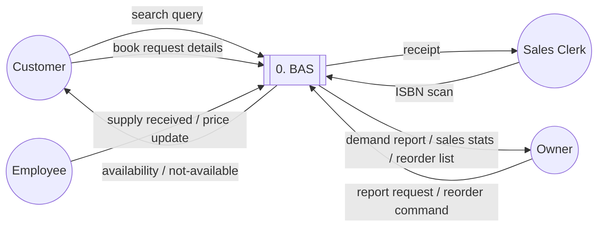
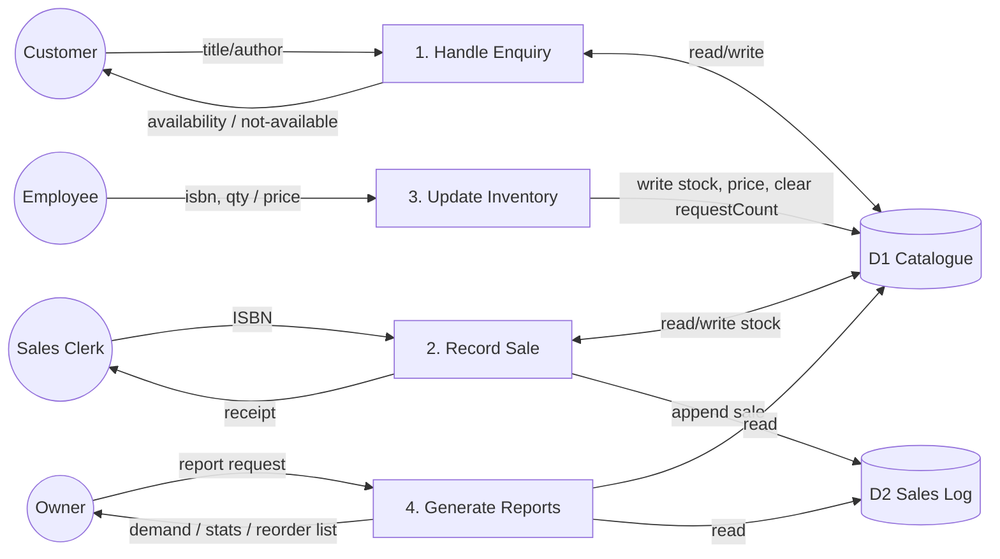
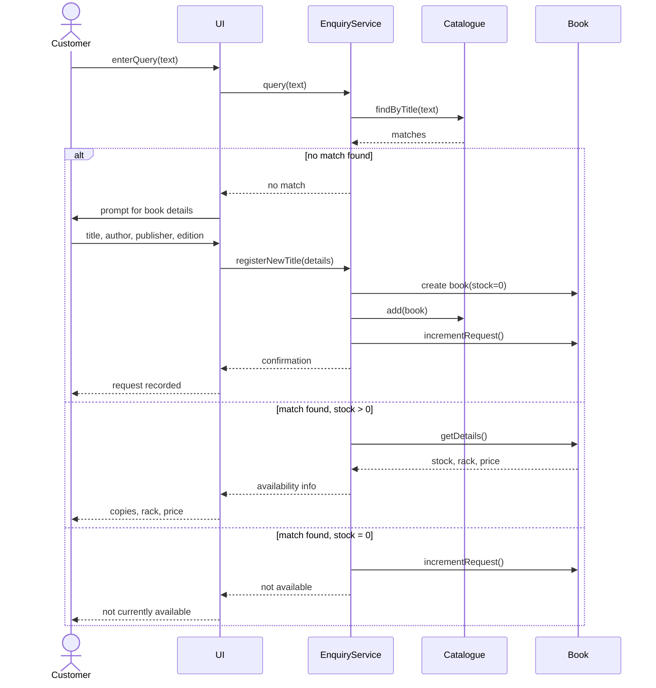
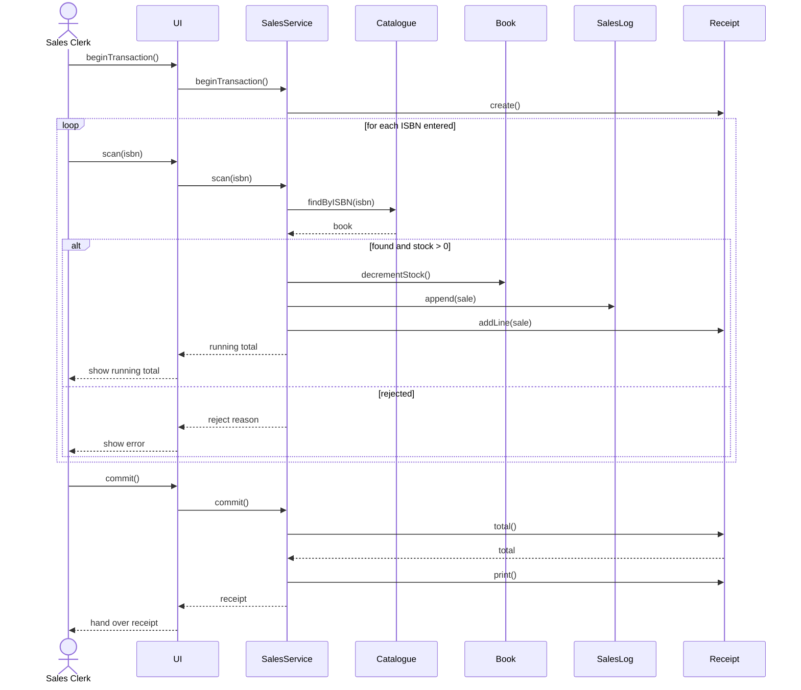
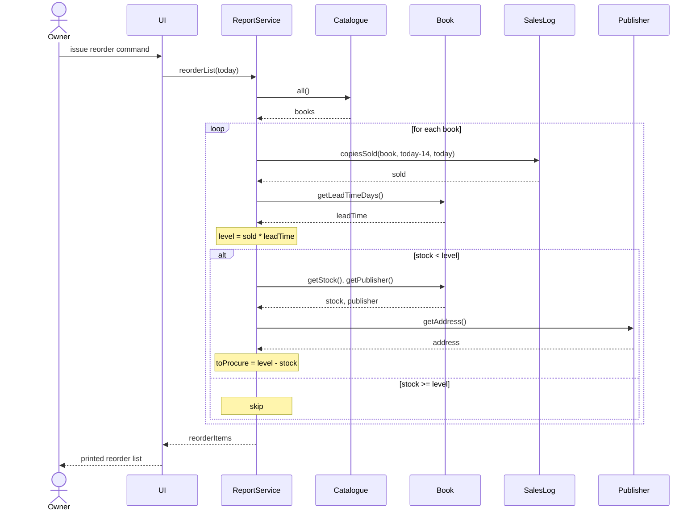
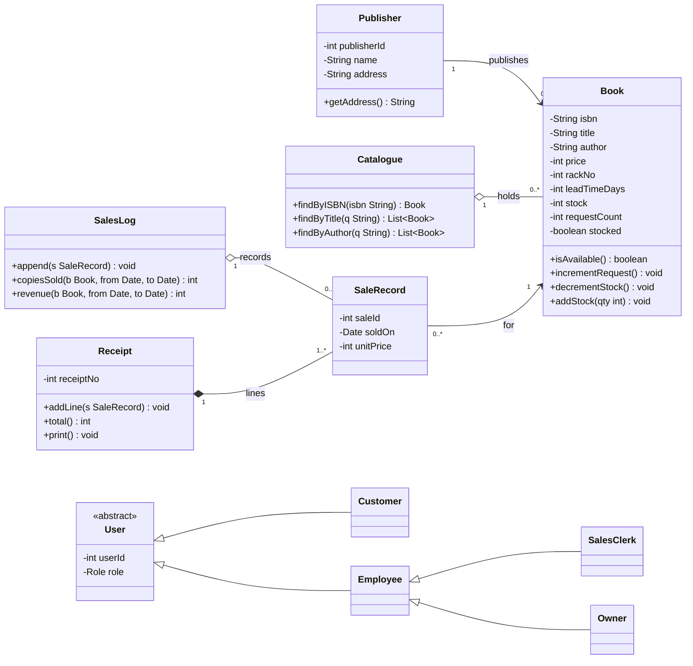
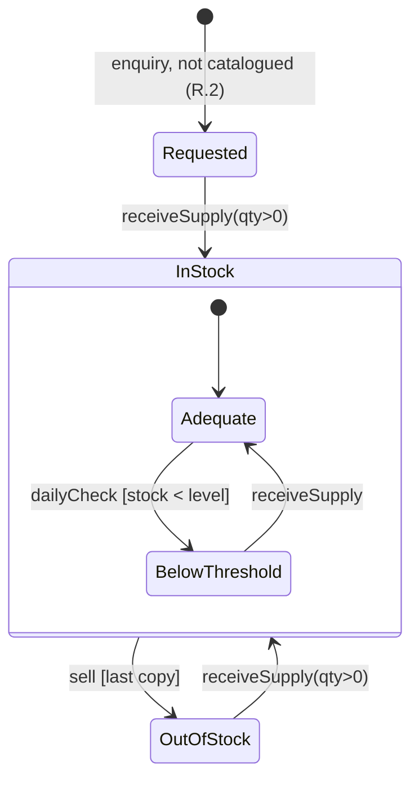
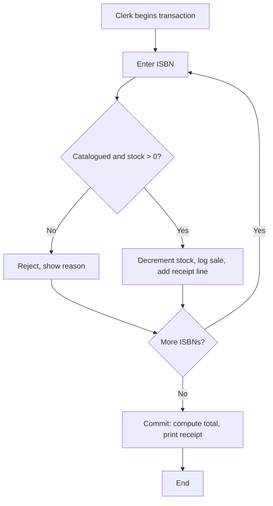

# BAS — Book-shop Automation Software

A single-shop management system for a bookstore. It covers four functions end to end:

1. **Customer availability enquiry** — search the catalogue, see stock/rack/price, or request a title the shop doesn't carry.
2. **Point of sale (POS)** — a clerk scans ISBNs, builds a cart, and commits an atomic sale that prints a receipt.
3. **Inventory receiving** — an employee books in new stock and updates prices.
4. **Owner reporting** — demand report, sales statistics over a date range, and a daily reorder list with publisher addresses.

The full product specification lives in [CLAUDE.md](CLAUDE.md). This README explains how the built system implements that spec: its architecture, data flow, API, business rules, and the pages/diagrams behind them.

---

## Table of contents

- [Requirements at a glance](#requirements-at-a-glance)
- [Tech stack](#tech-stack)
- [Repository structure](#repository-structure)
- [How it works (architecture)](#how-it-works-architecture)
- [Roles & access control](#roles--access-control)
- [Data model](#data-model)
- [Business rules](#business-rules)
- [API reference](#api-reference)
- [Frontend pages](#frontend-pages)
- [Diagrams](#diagrams)
- [Running locally](#running-locally)
- [Testing](#testing)
- [Deliberate scope & simplifications](#deliberate-scope--simplifications)

---

## Requirements at a glance

Every rule from the spec (R.1–R.9) is traceable to code via `// R.n` comments at the point it is enforced.

| Req | Description | Enforced in |
|---|---|---|
| R.1 | Enquire about availability | `GET /api/books` — [`routes/books.ts`](backend/src/routes/books.ts) |
| R.2 | Register a procurement request for an uncatalogued title | `POST /api/books/requests` — [`routes/books.ts`](backend/src/routes/books.ts) |
| R.3 | Increment request count when a searched title is out of stock | `GET /api/books` side effect — [`routes/books.ts`](backend/src/routes/books.ts) |
| R.4 | Maintain book price | `PATCH /api/books/:isbn/price` — [`routes/books.ts`](backend/src/routes/books.ts) |
| R.5 | Record a sale | `POST /api/sales` — [`services/sales.ts`](backend/src/services/sales.ts) |
| R.6 | Update inventory on supply received | `POST /api/books/:isbn/receive` — [`routes/books.ts`](backend/src/routes/books.ts) |
| R.7 | View demand report | `GET /api/reports/demand` — [`routes/reports.ts`](backend/src/routes/reports.ts) |
| R.8 | Generate sales statistics | `GET /api/reports/sales` — [`services/reports.ts`](backend/src/services/reports.ts) |
| R.9 | Print daily reorder list | `GET /api/reports/reorder` — [`services/reports.ts`](backend/src/services/reports.ts) |

---

## Tech stack

**Backend** — Node.js + Express + TypeScript, PostgreSQL via Prisma ORM. JWT auth for staff (bcrypt password hashing). Tested with Vitest.

**Frontend** — React + TypeScript + Vite, React Router for routing, TanStack Query for server state, TailwindCSS for styling.

**Infra** — Docker Compose runs local Postgres. No hosting is set up; everything runs on localhost.

Two conventions run through the whole system:

- **Money is integer paise, never floats.** `priceInPaise`, `unitPriceInPaise`, `totalInPaise`, `revenueInPaise` — all integers. The UI converts to `₹` only for display.
- **ISBN is the primary key** of `Book`.

---

## Repository structure

```
lib_sys/
├── backend/
│   └── src/
│       ├── index.ts              # entrypoint, starts the HTTP server
│       ├── app.ts                # Express app: middleware + route mounting + error handler
│       ├── db.ts                 # shared PrismaClient instance
│       ├── middleware/
│       │   └── auth.ts           # signToken, requireAuth (JWT), requireRole (guard)
│       ├── routes/
│       │   ├── auth.ts           # POST /auth/login
│       │   ├── books.ts          # enquiry, requests, price, receive  (R.1–R.4, R.6)
│       │   ├── sales.ts          # POST /sales, GET /sales/:receiptNo  (R.5)
│       │   └── reports.ts        # demand / sales / reorder            (R.7–R.9)
│       ├── services/
│       │   ├── sales.ts          # atomic + idempotent sale logic
│       │   └── reports.ts        # sales-stats + reorder computations
│       ├── prisma/
│       │   ├── schema.prisma     # data model
│       │   ├── seed.ts           # demo publishers, books, users
│       │   └── migrations/       # SQL migrations
│       └── tests/
│           └── rules.test.ts     # money-path rule tests
├── frontend/
│   └── src/
│       ├── main.tsx              # router + route guards + query client
│       ├── index.css             # Tailwind + shared component classes
│       ├── api/client.ts         # fetch wrapper, JWT storage, shared types
│       ├── components/Layout.tsx # header/nav shell
│       └── pages/                # Search, BookDetail, Login, POS, Inventory,
│                                 #   Demand, SalesStats, Reorder
├── docker-compose.yml            # local Postgres
├── CLAUDE.md                     # full product spec
└── README.md
```

**Layering:** thin routes handle HTTP + validation + auth; the two genuinely non-trivial pieces of logic (atomic sales, report computations) live in `services/`. Simple CRUD (enquiry, price, receive) stays in the route to avoid empty pass-through layers.

---

## How it works (architecture)

```
Browser (React SPA)
   │  fetch('/api/...')  with  Authorization: Bearer <jwt>  for staff routes
   ▼
Vite dev server  ──proxy /api──▶  Express (port 4000)
                                    │
                    ┌───────────────┼────────────────┐
                    ▼               ▼                ▼
              middleware/auth   routes/*        services/*
              (JWT + role)     (validation)    (sales, reports)
                                    │
                                    ▼
                              Prisma Client
                                    │
                                    ▼
                              PostgreSQL
```

**Request lifecycle for a staff call** (e.g. committing a sale):

1. The React page calls `api('/sales', { auth: true, ... })`. The wrapper in [`api/client.ts`](frontend/src/api/client.ts) attaches the JWT from `localStorage` as a `Bearer` token.
2. Vite proxies `/api/*` to the Express server on port 4000.
3. `requireAuth` verifies the JWT signature/expiry (401 on failure); `requireRole(CLERK)` checks the role (403 on mismatch).
4. The route validates the body, then delegates to `services/sales.ts`.
5. The service runs the whole sale inside a single Prisma transaction, so either every accepted line updates stock **and** the sales log, or nothing does.
6. The response bubbles back up; TanStack Query caches read results and the page re-renders.

**Auth model:** JWTs are signed with `JWT_SECRET`, expire in 8 hours, and carry `{ userId, role }`. Customers are unauthenticated — search, book detail, and requests need no token. The token lives in `localStorage`; on any `401` the client clears it and the user is bounced to `/login`.

**Error handling:** all handlers can be `async`; `express-async-errors` forwards any rejected promise to the central error middleware in [`app.ts`](backend/src/app.ts), which returns a `500` instead of crashing the process. Expected failures (validation, not-found, wrong role) are returned explicitly with the correct status code.

---

## Roles & access control

| Role | Auth? | Can do |
|---|---|---|
| **Customer** | No | Search, view a book, register a procurement request |
| **Sales Clerk** | Yes | Everything a customer can, plus record sales |
| **Employee** | Yes | Receive supply, update price |
| **Owner** | Yes | Inherits Employee, plus all reports and the reorder list |

**Owner inherits Employee** in both tiers:
- Backend — `requireRole(EMPLOYEE)` also admits `OWNER` (see [`middleware/auth.ts`](backend/src/middleware/auth.ts)).
- Frontend — the route `<Guard>` in [`main.tsx`](frontend/src/main.tsx) admits an `OWNER` wherever `EMPLOYEE` is allowed.

The frontend guard is a UX convenience only; the backend is the real authority — every protected endpoint independently verifies the token and role, so a hand-crafted request can't bypass a role check.

---

## Data model

Defined in [`schema.prisma`](backend/src/prisma/schema.prisma).

- **Publisher** `1 ──▶ 0..*` **Book** — a publisher publishes many books; the reorder list reads the publisher address.
- **Book** — the catalogue entry, keyed by `isbn`. Holds `stock`, `priceInPaise`, `rackNo`, `leadTimeDays`, `requestCount`, and `stocked`.
- **SaleRecord** — one line item of one sale; stores `unitPriceInPaise` **frozen at the time of sale** and links to a `Receipt`.
- **Receipt** — one committed sale. Persisted so a receipt is retrievable by `receiptNo` (reprint-safe) and so a retried commit with the same `idempotencyKey` returns the same receipt instead of double-charging.
- **User** — staff account with a bcrypt `passwordHash` and a `Role` enum (`CLERK` / `EMPLOYEE` / `OWNER`).

```prisma
model Book {
  isbn         String  @id
  title        String
  author       String
  publisherId  Int
  priceInPaise Int
  rackNo       Int?
  leadTimeDays Int     @default(0)
  stock        Int     @default(0)
  requestCount Int     @default(0)
  stocked      Boolean @default(false)
  // + relations: publisher, sales
  @@index([title])
  @@index([author])
}
```

> The `Receipt` model is an addition beyond the spec's class diagram. The spec's testing section requires receipts to be retrievable by `receiptNo` and sales to be idempotent under retries — both need a persisted receipt row, so it's modelled explicitly rather than derived.

---

## Business rules

These match the spec (section 11) exactly and are covered by tests.

- **Inventory level:** `inventoryLevel(isbn) = copiesSold(last 14 days) × leadTimeDays`
- **Below threshold:** `belowThreshold = stock < inventoryLevel`
- **To procure:** `toProcure = max(0, inventoryLevel − stock)`
- A title with **zero sales in the last 14 days** has `inventoryLevel = 0` and never appears on the reorder list, whatever its stock.
- A title with `leadTimeDays = 0` always has `inventoryLevel = 0` and is never flagged.
- **Stock never goes below zero.** A sale on a zero-stock ISBN is *rejected*, not clamped. The decrement is a conditional `updateMany({ where: { stock: { gt: 0 } } })`, so two concurrent requests for the last copy can't both succeed.
- **Receiving supply resets `requestCount` to 0** for that title.
- **A sale is atomic:** if it commits, every accepted line updates stock and the sales log together, or none do (single Prisma transaction).
- **Price changes apply to future sales only.** `SaleRecord.unitPriceInPaise` is captured at sale time and never rewritten, so a mid-transaction price change can't affect an in-flight sale.

---

## API reference

Base path `/api`. JSON throughout. Staff endpoints require `Authorization: Bearer <jwt>`.

| Method | Path | Auth | Body | Success | Notes |
|---|---|---|---|---|---|
| POST | `/auth/login` | None | `{username, password}` | `200 {token, role}` | `401` on bad credentials |
| GET | `/books?title=&author=` | None | – | `200 [Book]` | **R.1.** Matching a `stock=0` title increments its `requestCount` server-side (**R.3**) — a documented side effect of this GET |
| GET | `/books/:isbn` | None | – | `200 Book` / `404` | |
| POST | `/books/requests` | None | `{title, author, publisher, edition?}` | `201 {isbn, requestCount:1}` | **R.2.** Creates a stub with `stock=0, stocked=false`. `409` if it already resolves to an existing title |
| PATCH | `/books/:isbn/price` | Employee | `{priceInPaise}` | `200 Book` / `404` | **R.4.** Rejects `priceInPaise <= 0` with `400` |
| POST | `/books/:isbn/receive` | Employee | `{qty}` | `200 Book` / `404` / `400` | **R.6.** Rejects `qty <= 0` with `400`. Clears `requestCount`, sets `stocked=true` |
| POST | `/sales` | Clerk | `{items:[isbn,...]}` | `201 Receipt` | **R.5.** Atomic. Optional `Idempotency-Key` header |
| GET | `/sales/:receiptNo` | Clerk | – | `200 Receipt` / `404` | Reprint-safe retrieval |
| GET | `/reports/demand` | Owner | – | `200 [Book]` | **R.7.** `requestCount > 0`, sorted descending |
| GET | `/reports/sales?from=&to=` | Owner | – | `200 [SalesStatRow]` | **R.8.** `400` if `from > to` |
| GET | `/reports/reorder` | Owner | – | `200 [ReorderItem]` | **R.9.** Computed against the **server's** current date |

**Standard status codes:** `400` validation · `401` missing/invalid/expired token · `403` wrong role · `404` unknown ISBN · `409` duplicate request · `500` unhandled.

### Deriving the ISBN for a request (R.2)

The shop has no ISBN for a book it doesn't carry yet, so `POST /books/requests` derives a deterministic 13-digit key by hashing `title | author | edition`. Because the same details always hash to the same key, a duplicate request hits the unique-key constraint and returns **`409`** instead of silently creating a second stub. (See `isbnFromDetails` in [`routes/books.ts`](backend/src/routes/books.ts).)

### POST /sales — example

Request:
```json
{ "items": ["9780131103627", "9780131103627", "9780201896831"] }
```

Response `201`:
```json
{
  "receiptNo": 4821,
  "issuedOn": "2026-09-29",
  "lines": [
    { "isbn": "9780131103627", "title": "The C Programming Language", "unitPriceInPaise": 45000 },
    { "isbn": "9780131103627", "title": "The C Programming Language", "unitPriceInPaise": 45000 },
    { "isbn": "9780201896831", "title": "The Art of Computer Programming", "unitPriceInPaise": 120000 }
  ],
  "rejected": [],
  "totalInPaise": 210000
}
```

If an item is not catalogued or out of stock it appears in `rejected` with a `reason`; **the rest of the transaction still commits**. Rejection never aborts the loop.

**Idempotency:** send an `Idempotency-Key` header. The key is stored on the `Receipt`. If a client retries a timed-out commit with the same key, the server returns the original receipt — no second decrement, no duplicate receipt. The POS page generates one `crypto.randomUUID()` per cart for exactly this.

---

## Frontend pages

| Page | Route | Access | Purpose |
|---|---|---|---|
| **Search** | `/` | Public | Search by title/author; results show stock badge + price |
| **Book Detail** | `/books/:isbn` | Public | Availability/rack/price; or a "request this book" form when uncatalogued (`404`) |
| **Login** | `/login` | Public | Staff sign-in; redirects by role |
| **POS** | `/pos` | Clerk | Scan ISBNs, running cart total, commit, printable receipt |
| **Inventory** | `/inventory` | Employee | Receive stock, update price |
| **Demand Report** | `/reports/demand` | Owner | Request counts, descending |
| **Sales Statistics** | `/reports/sales` | Owner | Date range → per-title copies sold + revenue |
| **Reorder List** | `/reports/reorder` | Owner | Today's below-threshold titles with publisher address, printable |

**Notable frontend behaviours (from the spec's edge-case list):**

- **POS scans fetch fresh** — each scan re-fetches the book so a stale cached stock never lets a sold-out title into the cart.
- **Cart survives auth expiry** — if the JWT expires mid-transaction, the cart stays in state and the clerk is told to re-authenticate and retry (the idempotency key makes the retry safe).
- **Malformed ISBN guarded** — the POS input rejects anything that isn't 10–13 digits before hitting the server.
- **Double-submit guard** — the request form disables its button while submitting, so a double click can't create two stubs.
- **`from > to` guarded client-side** on Sales Statistics (and again server-side, which is authoritative).
- **Empty search** does nothing rather than fetching everything.
- **Print stylesheet** — `@media print` hides the app chrome so only the receipt / reorder list prints.

Styling is a shared component layer in [`index.css`](frontend/src/index.css) (`.card`, `.input`, `.btn-*`, `.th`, `.td`), so every page shares one look from a single source.

---

## Diagrams

These are the design diagrams from [CLAUDE.md](CLAUDE.md), reproduced here so the README is self-contained. GitHub renders Mermaid inline.

### Data flow — Level 0 (context)



### Data flow — Level 1



### Sequence — Enquiry (R.1 / R.2 / R.3)



### Sequence — Record Sale (R.5)



### Sequence — Daily Reorder List (R.9)



### Class diagram



### State — title lifecycle



### Activity — sale transaction



> **Implementation note:** the class/sequence diagrams describe an object model. The built system realizes it in a service + Prisma shape — `Catalogue`/`SalesLog` operations are Prisma queries against the `Book`/`SaleRecord` tables, and `EnquiryService`/`SalesService`/`ReportService` are the route + service modules. Behaviour matches the diagrams; the mechanism is relational.

---

## Running locally

Prerequisites: Node.js, Docker (for Postgres). No hosting required — everything runs on localhost.

```bash
# 1. Start Postgres
docker compose up -d db

# 2. Backend  ->  http://localhost:4000
cd backend
cp .env.example .env
npm install
npx prisma migrate dev      # apply migrations
npm run seed                # demo data (see logins below)
npm run dev

# 3. Frontend ->  http://localhost:5173  (proxies /api to the backend)
cd frontend
npm install
npm run dev
```

Open http://localhost:5173.

**Seeded staff logins** (password is `<username>123`):

| Username | Password | Role |
|---|---|---|
| `clerk` | `clerk123` | Clerk — POS |
| `employee` | `employee123` | Employee — Inventory |
| `owner` | `owner123` | Owner — Reports + inventory |

The seed also loads three books (including one out-of-stock and one non-Latin title) and two publishers. See [`seed.ts`](backend/src/prisma/seed.ts).

**Environment variables** (`backend/.env`, template in `.env.example`):

| Var | Purpose |
|---|---|
| `DATABASE_URL` | Postgres connection string |
| `JWT_SECRET` | Signing secret for staff JWTs |
| `PORT` | Backend port (default 4000) |

---

## Testing

```bash
cd backend && npm test
```

The suite in [`tests/rules.test.ts`](backend/src/tests/rules.test.ts) covers the money-path rules that matter most:

- **No overselling** — three sale attempts against a single copy accept exactly one, reject two, and leave stock at `0` (never negative).
- **Idempotency** — the same `Idempotency-Key` returns the same receipt and decrements stock only once.
- **Reorder computation** — a below-threshold title is flagged with `toProcure = inventoryLevel − stock`.
- **Lead-time zero** — a title with `leadTimeDays = 0` is never flagged, regardless of stock or sales.

---

## Deliberate scope & simplifications

Kept intentionally minimal; add these when they earn their place:

- **Frontend test suites** (Playwright e2e, React Testing Library) are not included — the one backend suite covers the risky logic. Add UI tests as the interface grows.
- **Rack / lead-time edit UI** — the documented API exposes only `price` and `receive`, so the Inventory page matches that contract. Add endpoints + fields if the shop needs to edit rack/lead-time through the UI.
- **Pagination on search** — the dataset is tiny; add it when result counts hurt.
- **Dark mode / component library** — not worth it for an internal tool.

> ⚠️ The Login page prints the seeded credentials for demo convenience. Remove that line before any real deployment.
